# Rest, pedal, grace-note, and tuplet fixes

This follow-up addresses #203, #206, #253, #255, and #268.

## Rests across voices (#203)

Join voices that share a stave before formatting them:

```js
new Formatter().joinVoices([upperVoice, lowerVoice]).formatToStave([upperVoice, lowerVoice], stave);
```

A rest now moves far enough to clear the other voice's chord and stem.
The previous formatter moved it by only one staff space.
The change applies to simultaneous notes in a shared modifier context.
It does not add collision detection across different tick positions.

## Annotations and pedal markings (#206)

Pedal text, brackets, and change notches now clear bottom annotations.
Placement considers intermediate notes in the participating voices, not just pedal events.
It uses the annotations' computed positions, so drawing order does not matter.

- Format notes and assign their staves before drawing the pedal.
- `pedal.getYForStave(stave)` returns the computed baseline before drawing.
- `pedal.setLine(line)` still sets the minimum distance below the stave.
- Explicit annotation baselines and vertical shifts are respected.
- This is not a general collision solver for every modifier or unrelated voice.

## Bounds before drawing (#253)

`GraceNoteGroup.getBoundingBox()` now works after formatting the parent note.
The parent must have a stave and tick context. No render context is required for measurement.

```js
parent.setStave(stave).addModifier(graceGroup, 0);
const voice = new Voice('4/4').addTickables(notes);
new Formatter().joinVoices([voice]).formatToStave([voice], stave);
const bounds = graceGroup.getBoundingBox();
```

- The box encloses the grace notes. It excludes the slur.
- Repeated measurements do not accumulate position offsets.
- Notehead and flag bounds use layout coordinates before drawing.
- `TextDynamics.getBoundingBox()` also uses page coordinates before drawing.
- Reformat after changing note sizes or moving the score.

## Grace-tab sizes (#255)

Set the fret size before formatting:

```js
const grace = new GraceTabNote({
  positions: [{ str: 2, fret: 12 }],
  duration: '8',
}).setFontSize(6);
```

Numbers use points. CSS sizes such as `'8px'` also work.
Widths are recalculated and fret text stays centered on its string.
Ghost-note changes preserve the requested size.
Call `setFontSize()` without an argument to restore the default.

The default fret size is the tab text size multiplied by the grace scale.
With the standard metrics, that is `9pt × 2/3 = 6pt`.
For a shared default, set `MetricsDefaults.GraceTabNote.fontScale` and call
`Metrics.clear('GraceTabNote')` before creating the notes.

## Tuplet timing (#268)

Create tuplets before adding notes to a strict voice:

```js
const notes = pitches.map((key) => new StaveNote({ keys: [key], duration: '8' }));
const tuplet = new Tuplet(notes, { numNotes: 3, notesOccupied: 2 });
const voice = new Voice('1/4').addTickables(notes);
```

The constructor attaches the tuplet. Calling `attach()` again is harmless.
V5 option names are `numNotes` and `notesOccupied`.

If notes must be inserted first, use a soft voice during construction:

```js
const voice = new Voice('1/4').setStrict(false).addTickables(notes);
const tuplet = new Tuplet(notes, { numNotes: 3, notesOccupied: 2 });
voice.setStrict(true);
new Formatter().joinVoices([voice]).format([voice], 300);
```

Voice totals, shortest duration, resolution, and spacing weights now refresh after duration edits.
Nested tuplets and detach operations are included.
A strict voice still rejects too many ticks at insertion time.
It cannot infer a tuplet that has not been created yet.
Reformat after editing durations.

## Validation and examples

```sh
npm test
node --test tools/p2-range-tests.mjs
```

The focused tests render both Bravura and Petaluma.
They check numeric clearance, pre-draw bounds, fret sizes, and tuplet timing.
The saved examples below use the same fixture before and after the fix.
For #253, the rectangle shows the box measured before drawing.

| Issue and example | Before | After |
| --- | --- | --- |
| #203: upper rest, Bravura | 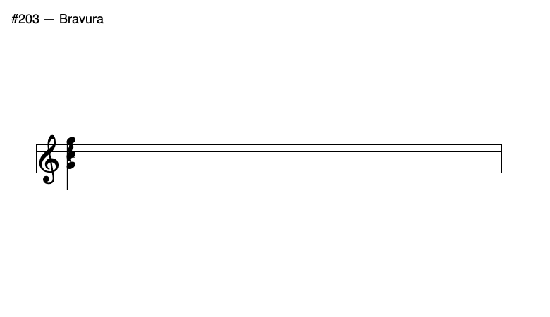 | 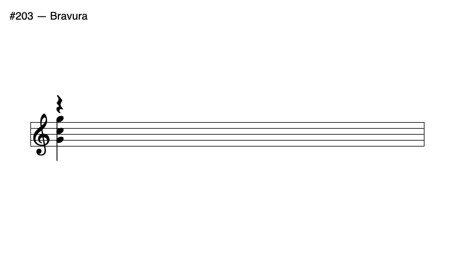 |
| #203: lower rest, Petaluma | 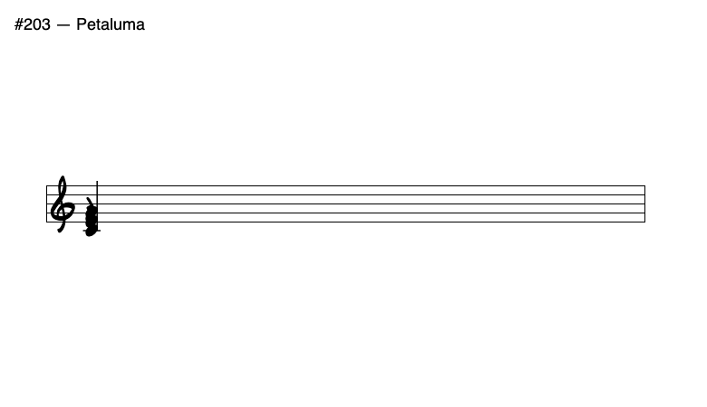 | 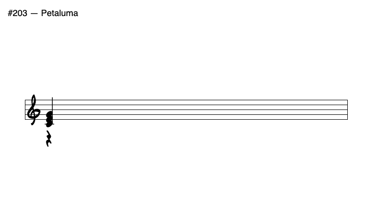 |
| #206: bracket, Bravura | 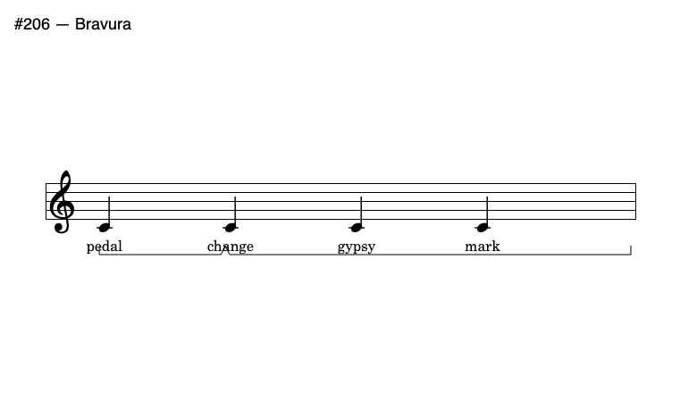 |  |
| #206: larger text, Petaluma | 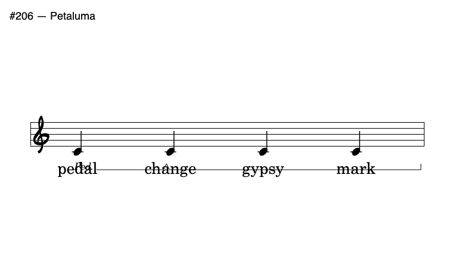 | 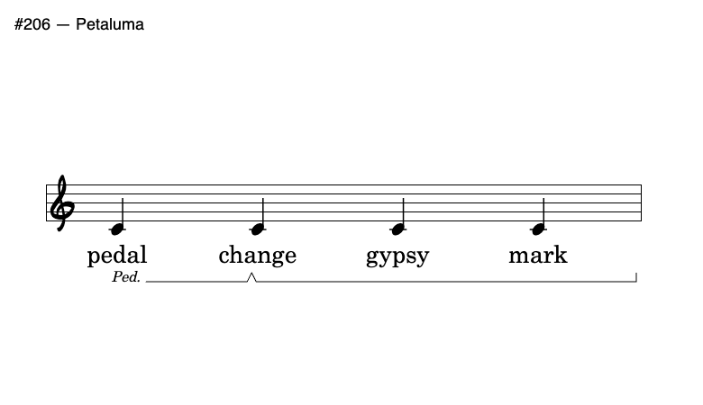 |
| #253: flags, Bravura | 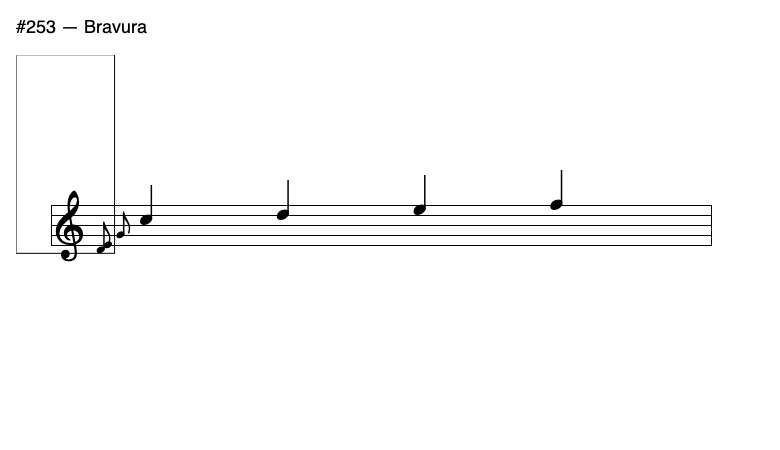 | 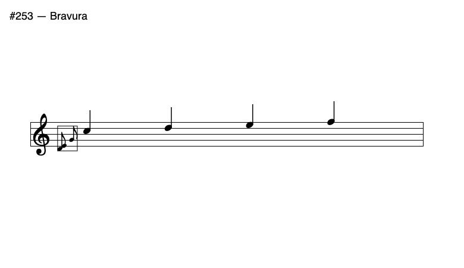 |
| #253: beam, Petaluma | 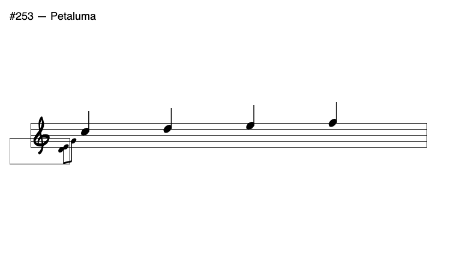 | 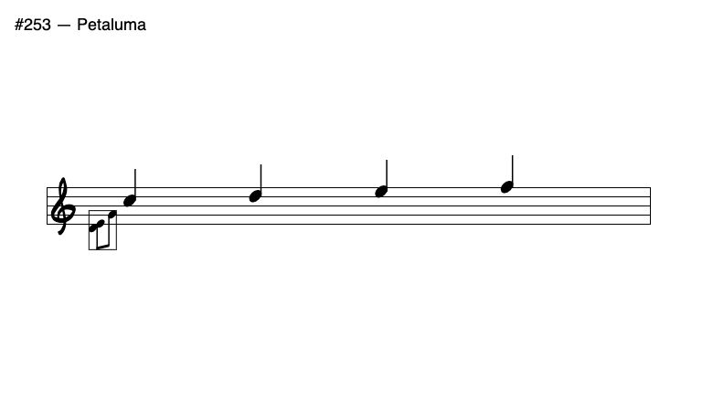 |
| #255: smaller frets, Bravura |  | 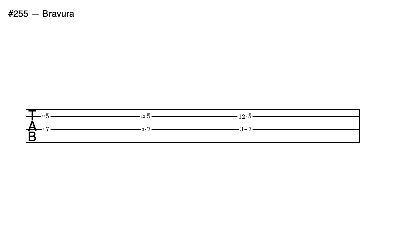 |
| #255: mixed CSS sizes, Petaluma | 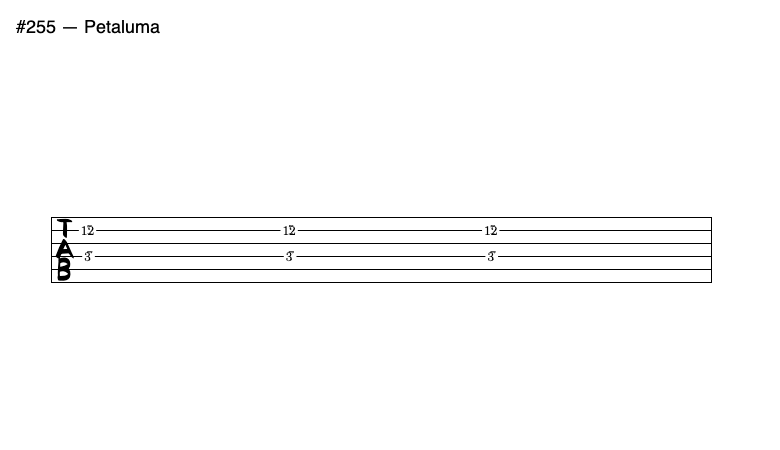 | 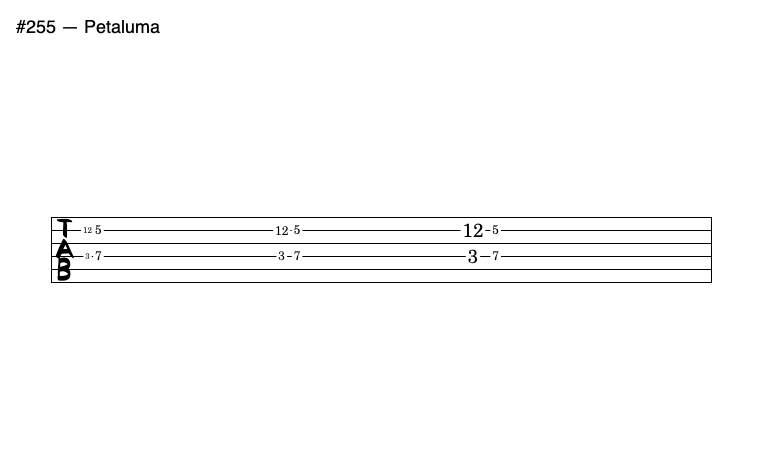 |
